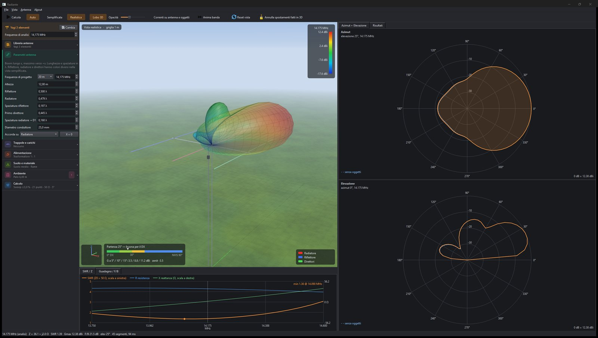
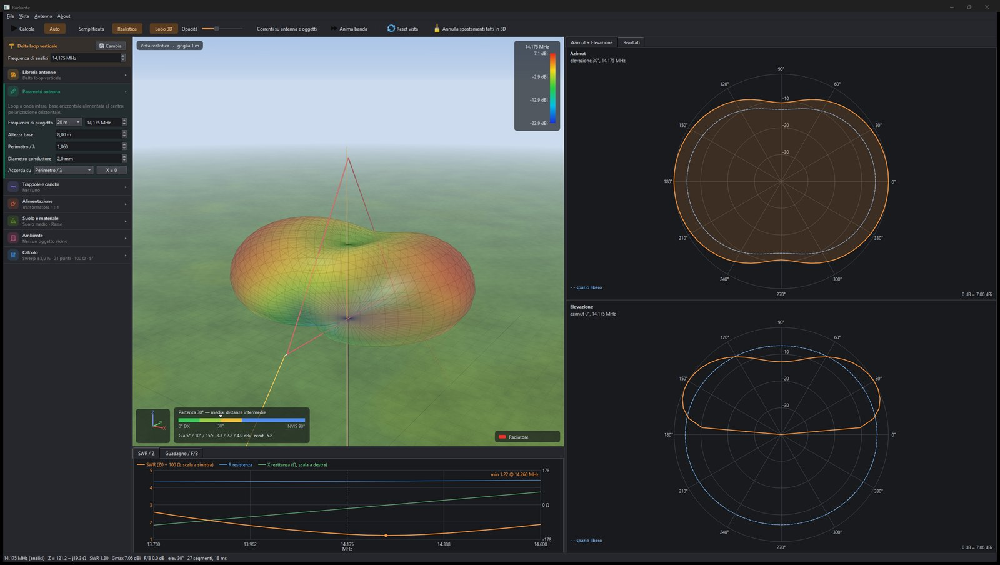
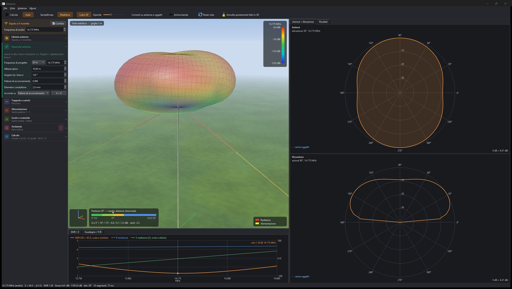
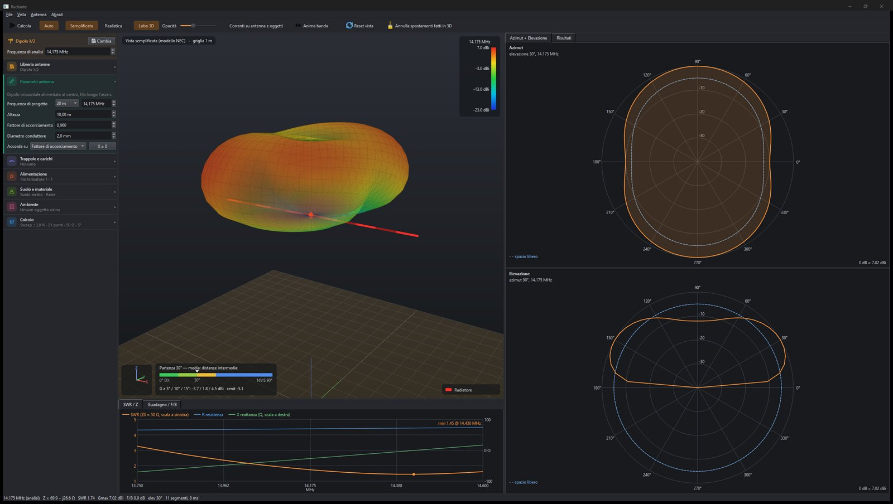
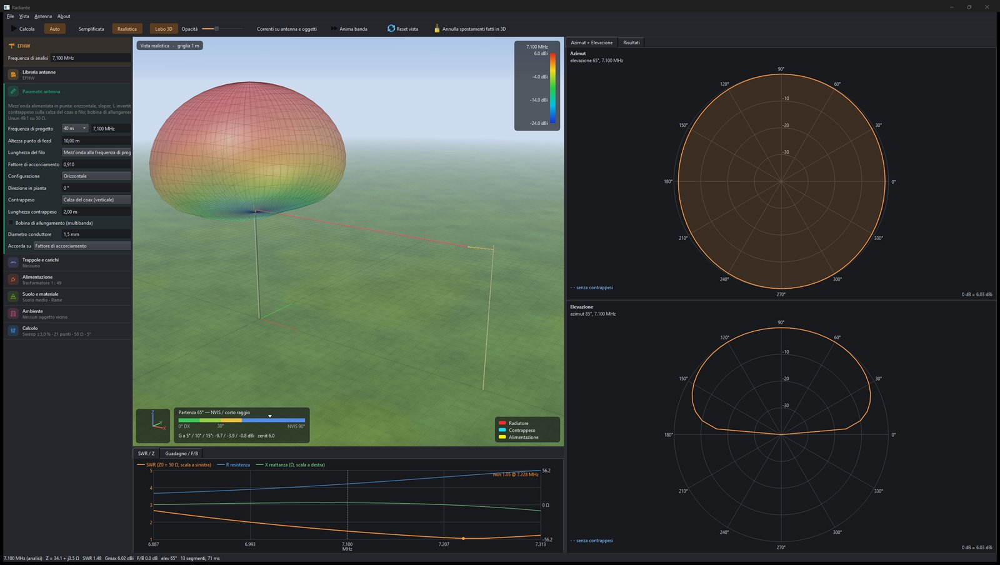

# Radiante

Programma per progettare e provare antenne da radioamatore prima di salire sul tetto. · *Design and try out amateur radio antennas before you climb onto the roof.*

**[Scarica l'ultima versione / Download the latest version](https://github.com/IU1WXY/radiante-releases/releases/latest)** · Windows 10/11, 64 bit

Radiante è gratuito, ma chiede una licenza gratuita: registrati su **[iu1wxy.com/radiante](https://iu1wxy.com/radiante)** e ricevi per email il file `radiante.aslic`. Al primo avvio, nella finestra Licenza, premi *Carica licenza...* e scegli il file.

*Radiante is free but asks for a free licence: register at **[iu1wxy.com/en/radiante](https://iu1wxy.com/en/radiante)** and you will get the `radiante.aslic` file by email. On first start, in the Licence window, press "Carica licenza..." (Load licence) and pick the file.*

| | |
|---|---|
|  |  |
|  |  |

## Cosa fa

Disegni l'antenna in 3D, la metti alla quota giusta sopra il tuo terreno, accanto al palo o sopra il tetto metallico, e vedi subito SWR, impedenza, guadagno e lobo. Sposti un filo col mouse e i grafici si aggiornano mentre lo trascini. Il calcolo è NEC-2 (motore OpenNEC) e gira dentro il programma, su tutti i core della CPU.

- SWR, R e X su tutta la banda; lobo 3D e tagli polari in azimut ed elevazione
- Suolo perfetto o reale (Sommerfeld), correnti sui fili, accordo automatico, trappole e carichi
- Procedura guidata, editor dei fili, trascinamento diretto nella vista 3D
- Import di `.nec`, `.yag`, `.ant`; export del deck `.nec` per confrontarlo con 4nec2 o EZNEC
- Libreria di dipoli, verticali, end-fed, loop, Yagi, quad, Moxon, hexbeam e alcune antenne commerciali

## What it does

You draw the antenna in 3D, put it at the right height over your ground, next to the mast or over a metal roof, and see SWR, impedance, gain and pattern straight away. Drag a wire and the graphs update while you drag it. The calculation is NEC-2 (OpenNEC engine), running inside the program on every CPU core.

## Problemi e offerte · Issues and donations

Bug e idee: [apri una segnalazione](https://github.com/IU1WXY/radiante-releases/issues) oppure scrivi a giovanni@iu1wxy.com.
Se Radiante ti è utile puoi sostenere il lavoro con un'offerta su [PayPal](https://paypal.me/talorno).

*Bugs and ideas: [open an issue](https://github.com/IU1WXY/radiante-releases/issues) or write to giovanni@iu1wxy.com. If you find Radiante useful you can support the work on [PayPal](https://paypal.me/talorno).*

## Componenti di terze parti · Third-party components

- [Qt 6](https://www.qt.io) — LGPL v3, usato come librerie dinamiche (le DLL nella cartella del programma si possono sostituire)
- [OpenNEC](https://github.com/maurymarkowitz/OpenNEC) — MIT
- [Monocypher](https://monocypher.org) — CC0 / BSD-2
- Runtime GCC/MinGW-w64 — GPL con eccezione per le librerie runtime

Radiante © Giovanni Ricciardi IU1WXY. Il codice sorgente di Radiante non è pubblicato. · *Radiante's own source code is not published.*
